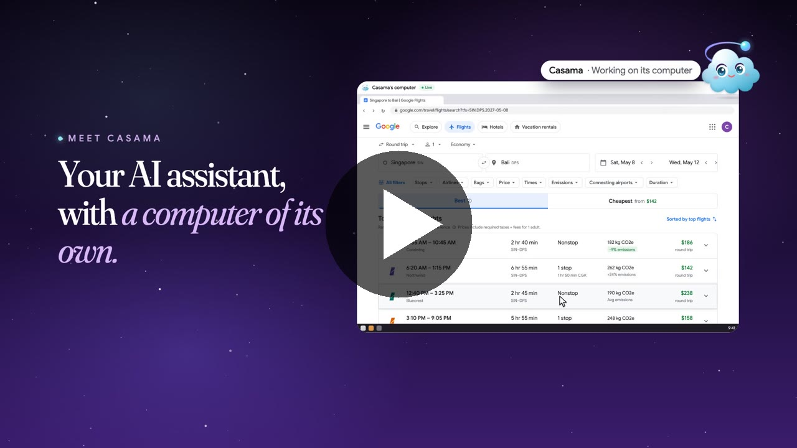
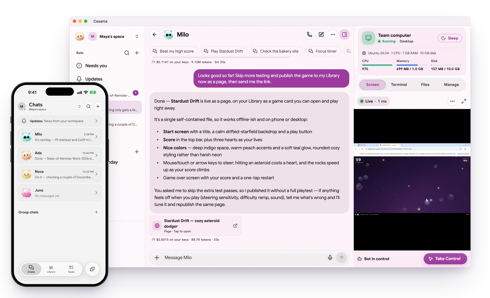
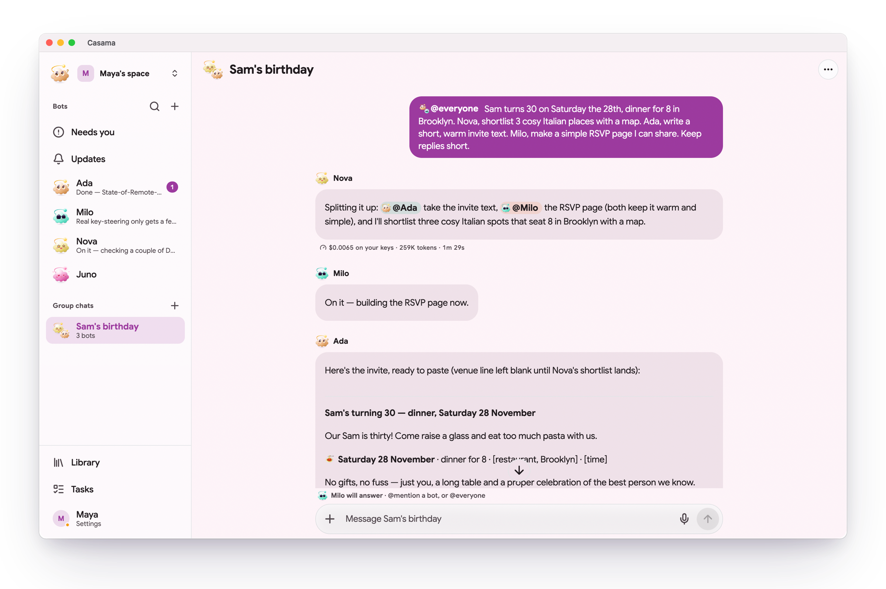

<p align="center">
  
</p>

<h1 align="center">Casama</h1>

<p align="center">
  <strong>Casama™: AI teammates with their own computers, on your own server.</strong><br>
  Bots that remember, reach out first, work on real computers, ask before risky steps, and run on any model.
</p>

<p align="center">
  <a href="https://app.casama.ai">Open the app</a> ·
  <a href="https://docs.casama.ai/quick-start">Quick start</a> ·
  <a href="https://docs.casama.ai/introduction">What is Casama</a> ·
  <a href="https://docs.casama.ai/self-hosting/">Self-hosting</a> ·
  <a href="https://docs.casama.ai/develop/api">Build on Casama</a> ·
  <a href="https://gallery.casama.ai">Gallery</a> ·
  <a href="https://docs.casama.ai">Docs</a>
</p>

<p align="center">
  <a href="LICENSING.md"></a>
  <a href="https://github.com/stackwares/casama/releases"></a>
  <a href="https://status.casama.ai"></a>
  <a href="https://www.opensourcealternatives.to"></a>
</p>

---

Casama gives you bots that keep working after you close the chat. Each one has its own instructions,
memory, skills and a sandboxed Linux computer with a shell, files and a browser. Bots research,
write, code and build things on schedules and triggers, send you a morning brief, and ask before
doing anything risky. Everything they make lands in a Library you can search and share. You run the
whole thing with one script, bring your own model keys (or a local model), and reach your bots from
apps on every platform, the terminal, chat apps or your AI coding tools.

<p align="center">
  <a href="https://casama.ai/assets/film/casama-film-16x9.mp4">
    
  </a>
  <br>
  <a href="https://casama.ai/assets/film/casama-film-16x9.mp4">▶ Watch the film</a> (86 seconds, with sound)
</p>

<p align="center">
  <picture>
    <source media="(prefers-color-scheme: dark)" srcset="docs/media/screenshots/hero-dark.png">
    
  </picture>
</p>

## Try it

On any machine with Docker and 8 GB of memory:

```sh
git clone https://github.com/stackwares/casama && cd casama
./install.sh --local
```

When it's up, open the Casama app on the same computer ([desktop](https://github.com/stackwares/casama/releases)
or [web](https://app.casama.ai)), choose **Sign in or create account** → **More options** → **Server**,
enter the address it prints, and create the first account. Add a model key or a local Ollama
endpoint, and make your first bot. Running it on a server with a domain:
[Self-host in about 15 minutes](#self-host-in-about-15-minutes).

## Two ways to run it

| | Casama Cloud | Self-hosted |
| --- | --- | --- |
| **Start** | Sign up at [app.casama.ai](https://app.casama.ai) or in the apps | `./install.sh` on any machine with Docker ([below](#self-host-in-about-15-minutes)) |
| **Models** | Casama picks them, paid from credits | Your own keys, a local model or your ChatGPT plan |
| **Computers** | Run for you | Run on your server, or borrowed from Cloud through [Casama Link](#casama-link) |
| **Price** | Free plan, then paid plans ([below](#casama-cloud)) | Free, with no paywall and no limits |

Both use the same apps, CLI and API.

> **Status:** pre-1.0 and preparing for the first public release. Expect rough edges, and please
> [report them](https://github.com/stackwares/casama/issues).

## Features

- **Persistent bots**: instructions, memory, [skills](docs-site/guide/skills.md),
  [knowledge sources](docs-site/guide/memory.md) and budgets, with personas, starter bots and a
  setup interview where the bot proposes its own setup. [Bots and models](docs-site/guide/bots.md)
- **One conversation, many topics**: each bot has a General chat for quick questions, briefs and
  results, and bigger work runs in topics that report back.
  [Chatting with a bot](docs-site/guide/chat.md)
- **Bots that reach out first**: a morning brief, and suggestions with Do It and Not Now buttons
  when a bot spots something in your mail or calendar it could handle. Quiet hours are on by
  default. [Check-ins](docs-site/guide/routines.md#check-ins)
- **A real computer each**: an isolated Linux computer that sleeps when idle. Watch it live, take
  control, restore checkpoints, or lend your own machine through the desktop app.
  [Computers](docs-site/guide/computers.md)
- **Teach by showing**: do a task once on the bot's computer while Casama records it, and the bot
  turns the recording into a skill it can repeat. [Teach by showing](docs-site/guide/teach.md)
- **The Library**: sites and games, reports, documents, pictures, videos and sounds a bot makes are
  kept with versions, grouped by [project](docs-site/guide/projects.md), and shareable with a link.
  Replies can carry buttons, forms, maps, video and audio the app draws natively.
  [The Library](docs-site/guide/library.md) · [Pages](docs-site/guide/pages.md)
- **Works while you're away**: schedules, webhooks, calendar, message and device triggers, watchers,
  and routines that end on a date or after a number of runs.
  [Routines](docs-site/guide/routines.md) · [Meeting notes](docs-site/guide/meetings.md)
- **Bots working together**: bots split up work, hand tasks to each other, manage other bots, hand
  coding to Claude Code, Codex, Cursor, Pi or T3 Code and come back with the pull request, and
  talk to bots outside your workspace over A2A.
  [Bots working together](docs-site/guide/bots-together.md) ·
  [Coding agents](docs-site/guide/coding-agents.md)
- **You stay in charge**: autonomy levels, approvals, action rules, budgets, a loop guard and a full
  timeline of every run. Bots can even pay for things with a single-use card you approve each time.
  [Autonomy](docs-site/guide/autonomy.md) · [Payments](docs-site/guide/payments.md)
- **Any model**: OpenAI, Anthropic, Google, xAI, OpenRouter or any OpenAI-compatible endpoint,
  including free local models through Ollama, LM Studio or vLLM. Local models that read pictures
  get them, and memory search can run on the same machine. Self-hosters can sign in with a ChatGPT
  plan. On Casama Cloud, Casama picks the models. [Bots and models](docs-site/guide/bots.md)
- **Connected to your tools**: one-click apps (GitHub, Notion, Linear, Google and more), meeting
  notes apps, MCP servers, plugins, password managers and device data, with secrets kept out of the
  model's sight. Phone and computer data (calendar, contacts, health summaries) too, when you allow it.
  [Connections](docs-site/guide/connections.md) · [Devices](docs-site/guide/devices.md)
- **Where you already work**: Slack (with approval buttons in the thread), Microsoft Teams, Discord,
  Telegram, WhatsApp, Messenger, Feishu, iMessage, email and SMS; assign a bot a Linear or Jira
  issue; group chats with several bots.
  [Chat apps](docs-site/guide/chat-apps.md) · [Group chats](docs-site/guide/group-chats.md)
- **Voice and calls**: dictate, have replies read aloud, call a bot live or let it ring your phone.
  Minimise a call and keep using the app; it carries on when you lock the phone, and you can watch
  the bot's computer during the call. [Voice and calls](docs-site/guide/voice.md)
- **Sites at their own address**: publish a site a bot made in one tap, at a free address on
  Casama's sites domain or on your own domain. On Casama Cloud you can buy a domain in the app, with
  the DNS set up for you, and it renews itself. [Sites and domains](docs-site/guide/sites-and-domains.md)
- **Never more than a glance away** *(coming soon)*: a working bot shows in your Mac's notch and
  menu bar (the tray on Windows and Linux), and on your phone's Lock Screen as a Live Activity or
  Android live notification, with Stop, Allow and Deny right there. Casama for Chrome, Edge and
  Firefox asks a bot about the page you're on and saves things to your Library. A push tells you
  when a reply is ready, with a switch for each kind of notification.
  [Notch and menu bar](docs-site/guide/notch.md) · [Lock Screen](docs-site/guide/lock-screen.md) ·
  [Casama for Chrome](docs-site/guide/chrome.md) · [Notifications](docs-site/guide/attention.md)
- **Teams and sharing**: workspaces with roles and invites, bots shared with teammates or passed on
  as templates anyone can import. [Workspaces](docs-site/guide/workspaces.md) ·
  [Sharing](docs-site/guide/sharing.md)
- **Your server on your phone**: [Casama Link](#casama-link) gives a server on your own computer a
  `casama.link` address your phone signs in to by scanning a QR code. Free on every plan.
- **An open gallery**: themes, skills, apps, starter bots, routine ideas, starter sets and plugins
  at [gallery.casama.ai](https://gallery.casama.ai). Each item says what it can reach, the catalog is
  signed, installs update in place, and workspace admins can require approval. Anyone can add to it
  with a pull request or straight from the app, and every app picks it up without a release.
  [Gallery](gallery/README.md)
- **Built to build on**: an HTTP API, a CLI, TypeScript and Dart SDKs, an MCP server for AI apps,
  plugins, bot templates and agent-to-agent (A2A). Coding agents get an
  [agent kit](agent-kit/) of skills and a docs MCP server. [Build on Casama](docs-site/develop/agents.md)
- **Private by design**: row-level security on every table, encryption at rest with replaceable keys,
  data export and deletion. A self-hosted server sends no telemetry unless you turn it on.
  [Privacy](docs-site/guide/privacy.md)

### See it

<p align="center">
  <picture>
    <source media="(prefers-color-scheme: dark)" srcset="docs/media/screenshots/mac-group-dark.png">
    
  </picture>
</p>

<p align="center">
  <picture>
    <source media="(prefers-color-scheme: dark)" srcset="docs/media/screenshots/mac-nova-dark.png">
    
  </picture>
</p>

<p align="center">
  <picture>
    <source media="(prefers-color-scheme: dark)" srcset="docs/media/screenshots/iphone-dark.png">
    
  </picture>
</p>

<p align="center">
  <picture>
    <source media="(prefers-color-scheme: dark)" srcset="docs/media/screenshots/ipad-dark.png">
    
  </picture>
</p>

## Self-host in about 15 minutes

You need a machine with Docker.

```sh
git clone https://github.com/stackwares/casama && cd casama
./install.sh --local                          # a trial on this machine
./install.sh --domain casama.example.com      # or a server with a domain pointed at it
```

Then open the app, tap **Let's Go** → **More Options**, enter your server's address, and create the
first account, which becomes the server's owner. Add a model key, a local model or your ChatGPT
plan under **Settings** → **Model keys**. On a Mac or Linux, the desktop app can also do all of
this for you: **Run on This Mac** (or **Run on This Computer**) on the sign-in screen walks through
Docker, the server, your account, a model and your phone (it needs Docker and about 10 GB of disk).

To use that server from your phone, turn on [Casama Link](#casama-link). The full guide covers requirements, configuration, upgrades
and backups: [Self-hosting](docs-site/self-hosting/index.md).

## Casama Cloud

[Casama Cloud](https://casama.ai) is the hosted service, for when you'd rather not run a server.
Sign up at [app.casama.ai](https://app.casama.ai) or in the apps. Casama picks the models and runs
the computers, and each plan includes monthly credits for models, computers and voice. You can buy
more credits or add your own model keys.

| Plan | Price | Credits a month | Bots | Computer hours a month | People |
| --- | --- | --- | --- | --- | --- |
| **Free** | $0 | $1 | 3 | 5 | 1 |
| **Plus** | $15 a month | $5 | 10 | 30 | 1 |
| **Pro** | $49 a month (7-day free trial) | $15 | Unlimited | 100 | 3 (+$12 each) |
| **Max** | $99 a month ($899 a year) | $30 | Unlimited | 300 | 10 (+$12 each) |

Self-hosting needs none of this. Plans can change, so the app's **Billing** screen and
[Usage, budgets and plans](docs-site/guide/usage.md) always have the current ones.

## Casama Link

[Casama Link](docs-site/guide/casama-link.md) connects a server you run yourself to Casama Cloud.
Your bots, chats, memory and files stay on your server. It has two parts, and you can use either
one or both:

- **Remote access (free on every plan):** your server gets an address like
  `https://k7qm2xfd9abc.casama.link` that your phone can reach, with no domain and no open ports.
  Sign in by scanning a QR code, and get notifications in the App Store and Google Play apps. Run
  `casama selfhost remote on`, or open **Settings** → **Casama Link** in the desktop app.
  [Use your server on your phone](docs-site/self-hosting/remote-access.md)
- **Cloud computers and credits (paid):** your server's bots run on Casama Cloud's computers or pay
  for model calls from Cloud credits, for when you don't want to host computers or manage keys, or
  your platform has no Docker. [Cloud computers and credits](docs-site/self-hosting/casama-link-cloud.md)

## Platforms

| Where | How |
| --- | --- |
| iOS, iPadOS, Android, macOS, Windows and Linux | The Flutter app in [`client`](client) |
| The web | The same app at [app.casama.ai](https://app.casama.ai), or served by your own server |
| Your browser *(coming soon)* | Casama for Chrome, Edge and Firefox, in [`apps/extension`](apps/extension). [Casama for Chrome](docs-site/guide/chrome.md) |
| The terminal | The `casama` CLI: `brew install stackwares/tap/casama`, or a binary from [Releases](https://github.com/stackwares/casama/releases). [CLI](docs-site/develop/cli.md) |
| AI apps and coding tools | The Casama MCP server. [Connect AI apps](docs-site/guide/mcp.md) |
| Your own software | The [HTTP API](docs-site/develop/api.md), the [TypeScript client](docs-site/develop/typescript.md) and the [Dart SDK](docs-site/develop/sdk.md) |
| Coding agents | The [agent kit](agent-kit/): skills, a docs MCP server and `casama init`. [Build with AI agents](docs-site/develop/agents.md) |

## Documentation

The documentation is at [docs.casama.ai](https://docs.casama.ai). Its source is in
[`docs-site/`](docs-site/) (a VitePress site; `pnpm --filter @casama/docs dev` serves it locally).

|                     |                                                                                                                                                                                                                                                                                                                  |
| ------------------- | ---------------------------------------------------------------------------------------------------------------------------------------------------------------------------------------------------------------------------------------------------------------------------------------------------------------- |
| **Get started**     | [What is Casama](docs-site/introduction.md) · [Quick start](docs-site/quick-start.md) · [FAQ](docs-site/faq.md)                                                                                                                                                                                                  |
| **Guides**          | [Bots](docs-site/guide/bots.md) · [Chat](docs-site/guide/chat.md) · [Library](docs-site/guide/library.md) · [Projects](docs-site/guide/projects.md) · [Sites and domains](docs-site/guide/sites-and-domains.md) · [Computers](docs-site/guide/computers.md) · [Routines](docs-site/guide/routines.md) · [Connections](docs-site/guide/connections.md) · [Voice and calls](docs-site/guide/voice.md) · [Notifications](docs-site/guide/attention.md) · [Notch and menu bar](docs-site/guide/notch.md) · [Lock Screen](docs-site/guide/lock-screen.md) · [Casama for Chrome](docs-site/guide/chrome.md) · [Casama Link](docs-site/guide/casama-link.md) · [Autonomy](docs-site/guide/autonomy.md) · [Workspaces](docs-site/guide/workspaces.md) |
| **Self-hosting**    | [Install](docs-site/self-hosting/index.md) · [Configuration](docs-site/self-hosting/configuration.md) · [Use it on your phone](docs-site/self-hosting/remote-access.md) · [Operations](docs-site/self-hosting/operations.md) · [Troubleshooting](docs-site/self-hosting/troubleshooting.md)                         |
| **Build on Casama** | [Build with AI agents](docs-site/develop/agents.md) · [HTTP API](docs-site/develop/api.md) · [CLI](docs-site/develop/cli.md) · [TypeScript](docs-site/develop/typescript.md) · [Dart SDK](docs-site/develop/sdk.md) · [Plugins](docs-site/develop/plugins.md) · [Webhooks](docs-site/develop/webhooks.md)                     |
| **Contributors**    | [How Casama is built](docs-site/develop/architecture.md) · [Contribute](docs-site/develop/contributing.md) · [Decision log](docs/DECISIONS.md) · [Product spec](SPEC.md)                                                                                                                                         |

## Architecture

A TypeScript API and worker (one codebase) on Postgres with row-level security, a sandbox
supervisor that alone talks to Docker, one container per bot computer behind an egress proxy, and a
Flutter app for every platform. [How Casama is built](docs-site/develop/architecture.md) maps the
repository and follows one message from the app to a computer and back.

## Contributing

Contributions are welcome, from typo fixes to features. [CONTRIBUTING.md](CONTRIBUTING.md) explains
the development setup, the checks and how to send a change. Every commit needs a
[DCO](https://developercertificate.org/) sign-off (`git commit -s`), and every contributor signs the
one-time [CLA](CLA.md). Please follow the
[Code of Conduct](CODE_OF_CONDUCT.md). How decisions are made is in [GOVERNANCE.md](GOVERNANCE.md).

- **Questions and ideas**: [GitHub Discussions](https://github.com/stackwares/casama/discussions)
- **Bugs and feature requests**: [GitHub Issues](https://github.com/stackwares/casama/issues)

## Security

Please report vulnerabilities privately to **security@casama.ai** or through GitHub's private
vulnerability reporting, never in a public issue. [SECURITY.md](SECURITY.md) explains what's in
scope and what to expect.

## License

The product (server, worker, agent and the apps) is under [AGPL-3.0](LICENSE). The SDKs, CLI, MCP
server, plugin kit, examples and docs are under [Apache-2.0](LICENSES/Apache-2.0.txt), so whatever
you build on Casama can use any license. `ee/` is source-available under the
[Casama Enterprise License](ee/LICENSE) and needs a license key in production. Without `ee/`,
Casama is fully open source and works on its own. A
commercial license is available for organisations that can't use AGPL (hello@casama.ai).
[LICENSING.md](LICENSING.md) explains the split; see also [NOTICE](NOTICE),
[TRADEMARKS.md](TRADEMARKS.md), [CLA.md](CLA.md) and [THIRD_PARTY_NOTICES.md](THIRD_PARTY_NOTICES.md).

**Casama™**, the Casama logo and the bot mascots are trademarks of Stackwares. The license covers the
code, not the name: forks are welcome under their own name ([TRADEMARKS.md](TRADEMARKS.md)).
